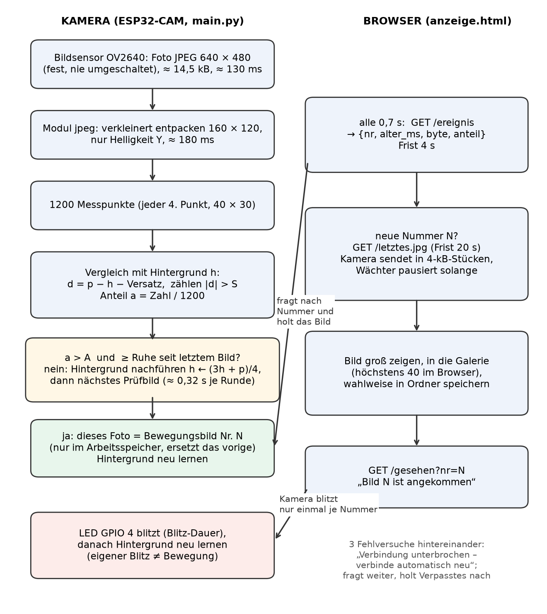
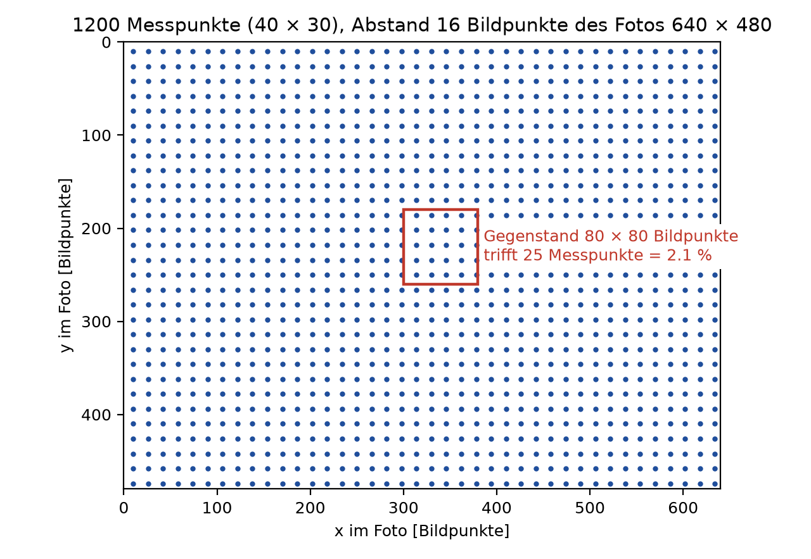
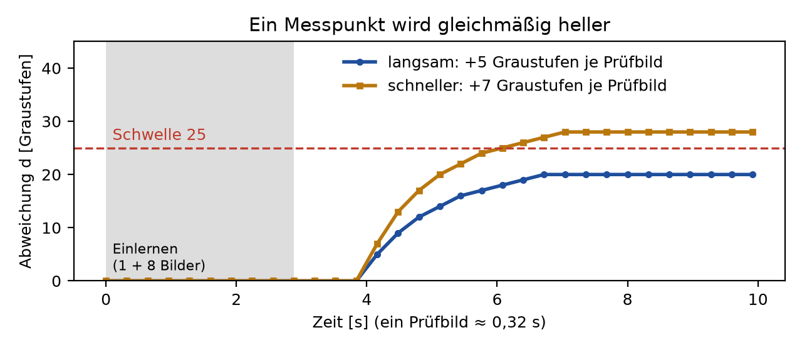

# Wozu dieses Manuskript

Die Kurzanleitung `LIESMICH_Bewegungsmelder_1.4` sagt, **wie man den Bewegungsmelder bedient**. Dieses Manuskript sagt,
**wie er arbeitet**. Es richtet sich an Ingenieurinnen und Ingenieure, die nicht an der Entwicklung beteiligt waren. Es
beschreibt:

- welche Bauteile beteiligt sind,
- wie aus einem Kamerabild die Entscheidung „Bewegung" wird, mit allen Zahlen,
- welche Einstellungen es gibt und was sie bewirken,
- wie das Bild zum Browser kommt und wann die LED blitzt,
- wo was gespeichert wird und wie lange es dort bleibt,
- wie sich das Gerät bei Fehlern selbst hilft und was davon geprüft ist.

Alle Zahlen stammen aus dem Programmtext (`esp_cam_bewegung_1.4.py`, `anzeige_bewegung_1.2.html`) oder aus Messungen an
der echten Kamera. Die Rechenbeispiele in Abschnitt 5 lassen sich von Hand nachrechnen. Sie sind zusätzlich mit den
Rechenregeln des Programms nachgerechnet (`manuskript/bilder_und_nachrechnung_1.0.py`, Ausgabe `….out`).

# Überblick

Die ESP32-CAM spannt ein **eigenes WLAN** auf. Sie macht laufend Fotos und vergleicht jedes mit einem gelernten
**Hintergrund**. Weicht ein genügend großer Teil des Bilds genügend stark ab, ist das eine **Bewegung**. Das Foto, in dem
die Bewegung erkannt wurde, wird zum **Bewegungsbild** und bekommt eine laufende Nummer.

Die Anzeigeseite liefert die Kamera selbst aus (`http://192.168.4.1/`). Sie fragt die Kamera alle 0,7 s nach der Nummer
des letzten Bewegungsbilds. Ist die Nummer neu, holt die Seite das Bild und zeigt es an. Danach meldet sie der Kamera:
„Bild N ist angekommen". **Erst dann blitzt die weiße LED.** Ein Blitz bedeutet also: Das Bild ist wirklich beim Betrachter.

{width=96%}

# Hardware

| Teil | Daten | Rolle im Programm |
|:--|:--|:--|
| Modul | ESP32-CAM, Bauart AI Thinker, auf dem USB-Brett ESP32-CAM-MB | Rechner, WLAN, Kamera-Anschluss |
| Prozessor | ESP32, zwei Kerne, WLAN 2,4 GHz | MicroPython 1.27 (Ausgabe „ESP32_GENERIC-SPIRAM“) |
| Zusatzspeicher | PSRAM, frei gemessen ≈ 3,5 MB | Bildpuffer, letztes Bewegungsbild |
| Bildsensor | OV2640 | liefert JPEG 640 × 480 |
| Kameratreiber | cnadler86 micropython-camera-API v0.6.2 | `Camera(...)`, `capture()` |
| Weiße LED | GPIO 4 | Blitz |
| Sensor-Abschaltung | GPIO 32 (PWDN des Sensors) | holt einen hängenden Sensor zurück |
| USB | seriell, 115200 Baud, am Kurs-Laptop COM5 | Aufspielen mit Thonny, Ausgaben (`print`) |

Ohne USB-Rechner läuft die Kamera an jedem USB-Netzteil. Die Ausgaben gehen dann ins Leere, das stört nicht.

# Dateien: wo was liegt

## Auf der Kamera (Flash-Dateisystem)

| Datei | Inhalt | Wer schreibt sie |
|:--|:--|:--|
| `main.py` | Kameraprogramm, Fassung 1.4 (= `esp_cam_bewegung_1.4.py`) | einmalig mit Thonny |
| `anzeige.html` | Anzeige- und Steuerseite 1.2 (= `anzeige_bewegung_1.2.html`), 24 091 Byte | einmalig mit Thonny |
| `einstellungen.json` | Schwelle, Anteil, Ruhe, Blitz, Wächter an/aus | das Programm, bei jedem gültigen Steuerbefehl |
| `kamera.json` | Name des WLANs (Schlüssel `name`, hier `VHS-CAM-3`) | Kurseinrichtung |
| `ap.json` | wahlweise: Kennwort für das WLAN (mindestens 8 Zeichen) | von Hand; auf der Kurskamera nicht wirksam, das Netz ist offen |
| `main_1.3.py`, `anzeige_1.1.html` | Sicherung der Vorfassung | beim Aufspielen von 1.4 umbenannt |

Beim Einschalten startet MicroPython `main.py` von selbst. Das Programm liest `einstellungen.json` und `kamera.json`.
Fotos werden auf der Kamera **nicht** in Dateien geschrieben (siehe Abschnitt 8).

Beispiel `einstellungen.json` mit den Vorgaben:

```
{"schwelle": 25, "anteil": 0.02, "ruhe_ms": 3000, "blitz_ms": 120, "wache": true}
```

## Auf dem Kurs-Laptop

Ordner `C:\VHS_Kurs\ESP32CAM Bewegungsmelder`:

- Programm, Seite, `LIESMICH_Bewegungsmelder_1.4`, `kameraprobe_1.0.py` (prüft, ob die Firmware alles Nötige kann)
- `pruefung\`: Prüfprogramme und Prüfprotokolle
- `alt\`: Vorfassungen 1.0 bis 1.3

# Bewegungserkennung im Einzelnen

## Foto und Verkleinerung

Die Kamera nimmt **immer dasselbe Format** auf: JPEG, 640 × 480 Bildpunkte, Qualitätswert 85 des Treibers, zwei
Bildpuffer. Ein Foto ist an der echten Kamera etwa **14,5 kB** groß.

**Warum nur ein Format:** Frühere Fassungen schalteten zwischen Graubild (zum Rechnen) und JPEG (zum Senden) um. An der
echten Kamera scheiterte das Umschalten nach etwa 3 Minuten mit `ESP_ERR_NOT_SUPPORTED`. Danach ging die Kamera erst
wieder, nachdem man das Kabel abgezogen hatte.

Zum Rechnen wird jedes Foto auf dem Chip entpackt, und zwar gleich verkleinert auf **160 × 120** Punkte. Das macht das
Modul `jpeg` der Firmware (`jpeg.Decoder`, Format `CbYCrY`). Verwendet wird nur die **Helligkeit Y** (0 = schwarz,
255 = weiß). Die Farbe wird nicht ausgewertet. Im Format CbYCrY steht Y an jeder zweiten Stelle: Punkt $k$ hat seine
Helligkeit im Byte $2k+1$.

Gemessene Zeiten an der echten Kamera: Aufnahme etwa 130 ms, Entpacken etwa 180 ms. Mit dem Vergleich ergibt das
**≈ 3,1 Prüfbilder je Sekunde**, also $T \approx 0{,}32\ \text{s}$ je Prüfbild. Das ist im Dauerlauf gemessen:
658 Prüfbilder in 210 s.

## Messraster: 1200 Punkte

Aus dem 160 × 120-Bild wird **jeder 4. Punkt in beide Richtungen** genommen. Es beginnt bei Punkt 2, damit jeder
Messpunkt nahe der Mitte seines 4 × 4-Felds liegt:

$$x \in \{2, 6, 10, \dots, 158\}\ (40\ \text{Spalten}),\qquad y \in \{2, 6, 10, \dots, 118\}\ (30\ \text{Zeilen}),\qquad 40 \cdot 30 = 1200 .$$

Ein Punkt des 160 × 120-Bilds steht für 4 × 4 Punkte des Fotos. Benachbarte Messpunkte liegen im Foto also
**16 Bildpunkte** auseinander.

{width=80%}

**Warum nicht alle Punkte:** MicroPython rechnet langsam. Eine Schleife über 1200 Punkte passt in die 0,32 s je
Prüfbild, eine über 19 200 Punkte nicht.

## Vergleich mit dem Hintergrund

Es seien $p_i$ die Helligkeiten der 1200 Messpunkte des neuen Bilds und $h_i$ der gelernte Hintergrund, $i = 1 \dots N$
mit $N = 1200$.

**Schritt 1, gleichmäßige Änderung abziehen.** Die Kamera regelt die Belichtung selbst nach. Wird es im Raum heller,
steigen alle Punkte ungefähr gleich. Das ist keine Bewegung. Deshalb wird zuerst die mittlere Änderung bestimmt
(ganzzahlig, abgerundet):

$$v = \left\lfloor \frac{1}{N}\sum_{i=1}^{N} (p_i - h_i) \right\rfloor .$$

**Schritt 2, Abweichung je Punkt:**

$$d_i = p_i - h_i - v .$$

**Schritt 3, zählen.** Ein Punkt gilt als verändert, wenn $|d_i| > S$ ist. $S$ ist die **Schwelle**, Vorgabe
25 Graustufen. Es zählt also heller **und** dunkler.

**Schritt 4, Anteil:**

$$a = \frac{\text{Zahl der Punkte mit } |d_i| > S}{N} .$$

## Entscheidung

Eine **Bewegung** liegt vor, wenn beide Bedingungen erfüllt sind:

1. $a > A$. $A$ ist der **Anteil**, Vorgabe 2 %. Es gilt „größer als“, nicht „größer gleich“.
2. Seit dem letzten Bewegungsbild ist mindestens die **Ruhe** vergangen, Vorgabe 3 s.

Bei $A = 0{,}02$ und $N = 1200$ heißt das: $z/1200 > 0{,}02$, also $z > 24$. **Es müssen mindestens 25 Messpunkte
verändert sein.**

Dann wird **genau dieses Foto**, das schon als JPEG vorliegt, zum Bewegungsbild. Es muss nicht nachträglich ein zweites
Foto gemacht werden. Auf der USB-Ausgabe erscheint zum Beispiel:

```
00:01:23  BEWEGUNG Nr. 2  (9 % der Punkte verändert)  Foto 14 kB
```

## Der Hintergrund läuft mit

Ist keine Bewegung erkannt, wird der Hintergrund an jedem Messpunkt nachgeführt, mit ¾ alt und ¼ neu (ganzzahlig,
abgerundet):

$$h_i \leftarrow \left\lfloor \frac{3\,h_i + p_i}{4} \right\rfloor .$$

Das ist ein Tiefpass erster Ordnung. Ein alter Wert hat nach $n$ Prüfbildern noch das Gewicht $(3/4)^n$. Die Zeitkonstante
ist

$$\tau = \frac{-T}{\ln(3/4)} = \frac{0{,}32\ \text{s}}{0{,}288} \approx 1{,}1\ \text{s}.$$

**Folge 1: Langsame Änderungen werden geschluckt.** Wird ein Punkt je Prüfbild um $\delta$ Graustufen heller, stellt sich
diese bleibende Abweichung ein:

$$e_n = \delta + \tfrac{3}{4}\,e_{n-1} \quad\Rightarrow\quad e_\infty = 4\,\delta .$$

Ausgelöst wird nur bei $4\delta > S$. Mit $S = 25$ heißt das $\delta > 6{,}25$ Graustufen je Prüfbild, also etwa
**20 Graustufen je Sekunde**. Abbildung 3 zeigt das mit dem Rechenweg des Programms: Bei +5 je Bild bleibt die Abweichung bei
20, bei +7 je Bild steigt sie auf 28 und löst aus. Ein langsam aufziehender Schatten löst darum nicht aus, eine gehende
Person schon.

{width=90%}

**Folge 2: Abrunden.** Wegen des Abrundens kann der Hintergrund bis zu 3 Graustufen unter einem gleichbleibend helleren
Wert hängen bleiben. Ein Beispiel: $h = 100$, $p = 103$, dann ergibt sich $\lfloor 403/4 \rfloor = 100$. Gegen die
kleinste zulässige Schwelle von 5 ist das unerheblich.

## Einlernen, Ruhe und Totzeit

**Einlernen:** Ist kein Hintergrund vorhanden, wird das erste Bild zum Hintergrund. Die folgenden **8 Bilder** werden
nur eingemischt, ohne Vergleich. Danach hat das erste Bild noch das Gewicht $(3/4)^8 \approx 10\ \%$. Ein vollständiges
Einlernen dauert also 9 Prüfbilder, etwa **2,9 s**. Die Zahl 8 ist fest im Programm (`EINLERNEN`) und nicht einstellbar.

Neu eingelernt wird in diesen Fällen:

| Anlass | Grund |
|:--|:--|
| Programmstart | noch kein Hintergrund |
| nach jedem Bewegungsbild | der neue Zustand, z. B. ein abgestellter Gegenstand, wird Hintergrund; sonst löste er dauernd aus |
| nach jedem LED-Blitz (auch LED-Test) | der eigene Blitz soll nicht als Bewegung zählen |
| nach „Foto jetzt“ | wie nach einem Bewegungsbild |
| Wächter wird wieder eingeschaltet | Bild kann sich in der Zwischenzeit geändert haben |
| Kamera wurde neu gestartet | wie Programmstart |

**Wann frühestens das nächste Bewegungsbild kommt:** Sind seit dem letzten Bewegungsbild 3 s vergangen (Ruhe), ist das
Einlernen (2,9 s) meist auch fertig. Der Blitz kommt aber erst, wenn das Bild beim Browser ist, und er startet das
Einlernen noch einmal. Ungefähr gilt deshalb:

$$t_\text{nächstes} \gtrsim \max\left(t_\text{Bewegung} + \text{Ruhe},\ \ t_\text{Blitz} + 2{,}9\ \text{s}\right).$$

Während ein Bild gesendet wird, pausiert die Erkennung (Abschnitt 7).

## Rechenbeispiele zum Nachrechnen

**Beispiel A: Wie groß muss ein Gegenstand sein?** Die Messpunkte liegen gleichmäßig. Der Anteil getroffener Punkte ist
deshalb ungefähr der Flächenanteil des Gegenstands im Bild. Bei $A = 2\ \%$ muss der Gegenstand mehr als 2 % der
Bildfläche bedecken. Weil die Messpunkte im Foto genau 16 Bildpunkte auseinanderliegen, enthält eine Strecke von
$16\,k$ Bildpunkten, wo immer sie liegt, genau $k$ Messpunkte. Daraus folgt:

- Ein Quadrat von **80 × 80** Bildpunkten trifft immer genau 5 × 5 = **25** Punkte, das sind 2,1 %. Es löst gerade aus
  (Abbildung 2).
- Ein Quadrat von **64 × 64** trifft immer genau 4 × 4 = **16** Punkte und löst nicht aus.
- Dazwischen hängt es von der Lage zum Raster ab.

Vorausgesetzt ist, dass der Kontrast an jedem getroffenen Punkt über der Schwelle liegt (Beispiel B).

Umrechnung in Meter: Man misst einmal, wie breit die Szene in der Entfernung $L$ ist (Breite $W$, z. B. mit einem
Zollstock im Bild). Das Bild hat das Seitenverhältnis 4 : 3, die Szene ist also $0{,}75\,W$ hoch. Ein quadratischer
Gegenstand mit Seite $s$ löst aus, wenn

$$\frac{s^2}{W \cdot 0{,}75\,W} > A \quad\Rightarrow\quad s > W\sqrt{0{,}75\,A} = 0{,}122\,W \quad (A = 0{,}02).$$

Bei $W = 2$ m sind das etwa **25 cm**. Ein Mensch, der durch das Bild geht, löst sicher aus, eine Fliege nicht.

**Beispiel B: Kontrast und Versatz.** Ein Gegenstand bedeckt den Anteil $f$ der Messpunkte und ist um $c$ Graustufen
heller als der Hintergrund. Dann gilt:

$$v \approx f\,c,\qquad d_\text{Gegenstand} \approx c\,(1-f),\qquad d_\text{Rest} \approx -f\,c .$$

- $f = 0{,}1$, $c = 100$: Versatz $v = 10$, Gegenstand $d = 90 > 25$ verändert, Rest $d = -10$ unverändert. Ergebnis
  $a = 10\ \%$, Bewegung. Das Programm rechnet genau so: 0,100.
- $f = 0{,}5$, $c = 60$: Versatz $v = 30$, Gegenstand $d = 30$, Rest $d = -30$. Beide liegen über der Schwelle, also
  $a = 100\ \%$, Bewegung. Das Programm rechnet: 1,000.
- $f = 1$, das ganze Bild wird gleichmäßig heller: $d = 0$ überall, **keine** Bewegung. Genau dafür ist der Versatz da.

Ein Gegenstand löst nur aus, wenn sein Kontrast groß genug ist: $c\,(1-f) > S$. Ein graues Hemd vor einer grauen Wand
mit $c = 20$ löst bei $S = 25$ **nicht** aus.

## Was erkannt wird und was nicht

| Vorgang | Erkannt? | Warum |
|:--|:--|:--|
| Person geht durchs Bild | ja | große Fläche, hoher Kontrast, schnell |
| Licht im Raum geht an | in der Regel nein | gleichmäßige Änderung, wird als Versatz abgezogen |
| Sonne wandert, Schatten zieht langsam | nein | unter 20 Graustufen je Sekunde, Hintergrund läuft mit |
| Licht geht nur in einer Bildhälfte an | ja | ungleichmäßige Änderung über großer Fläche |
| kleiner Gegenstand (< 2 % der Fläche) | nein | zu wenige Messpunkte |
| Gegenstand ähnlich hell wie Hintergrund | nein | Kontrast unter der Schwelle (nur Helligkeit, keine Farbe) |
| Bewegung zwischen zwei Messpunkten (< 16 Bildpunkte) | nein | kein Messpunkt getroffen |
| Bewegung innerhalb der Ruhezeit oder beim Einlernen | nein | gewollt, gegen Dauerauslösen |

# Einstellungen

| Name | Vorgabe | Grenzen | Bedeutung | Wirkung beim Erhöhen |
|:--|:--|:--|:--|:--|
| Schwelle $S$ | 25 | 5 … 100 Graustufen | ab dieser Abweichung zählt ein Messpunkt | weniger empfindlich gegen schwachen Kontrast und Rauschen |
| Anteil $A$ | 2 % | 0,5 … 50 % | so viele Messpunkte müssen verändert sein | erst größere Gegenstände lösen aus |
| Ruhe | 3 s | 1 … 60 s | Mindestabstand zweier Bewegungsbilder | weniger Bilder bei Dauerbewegung |
| Blitz | 120 ms | 20 … 1000 ms | Leuchtdauer der LED | längerer Blitz |
| Wächter | an | an / aus | Erkennung läuft oder ruht | – |

**Wie man sie ändert:** auf der Seite rechts unter „Kamera steuern“, dann **Einstellungen übertragen**. Die Seite
schickt `GET /steuern?schwelle=…&anteil=…&ruhe_ms=…&blitz_ms=…`. Der Anteil geht dabei als Zahl zwischen 0 und 1, die
Ruhe in ms.

**Prüfung an zwei Stellen:**

1. Die Seite überträgt nichts, wenn ein Feld leer ist oder außerhalb der Grenzen liegt, und sagt warum.
2. Die Kamera prüft noch einmal (`GRENZEN` im Programm). Ist **ein** Wert falsch, übernimmt sie **keinen** und antwortet
   mit `400` und dem Grund, z. B. `schwelle: 999 liegt nicht in 5 … 100`. Das ist an der echten Kamera geprüft.

**Wo sie bleiben:** Gültige Werte schreibt die Kamera sofort nach `einstellungen.json`. Beim nächsten Einschalten werden
sie wieder geladen, auch der Zustand des Wächters. **Wer den Wächter ausschaltet, findet ihn nach einem Neustart
ausgeschaltet vor.**

**Faustregeln zum Einstellen:**

- Löst die Kamera ohne Grund aus (flackerndes Licht, Bildschirm, Vorhang im Wind): erst die **Schwelle** auf 35 bis 40
  erhöhen, dann den **Anteil**.
- Werden kleine Tiere oder Gegenstände nicht erkannt: **Anteil** auf 0,5 bis 1 % senken (6 bis 12 Punkte). Damit steigt
  das Risiko für Fehlauslösungen.
- Kommen zu viele Bilder hintereinander: **Ruhe** erhöhen.

# Übertragung und LED

## Die Adressen der Kamera (Webserver, Port 80)

| Anfrage | Antwort | Wirkung |
|:--|:--|:--|
| `GET /` | `anzeige.html` aus dem Flash in 2-kB-Stücken; fehlt die Datei: kurze Notseite | – |
| `GET /ereignis` | JSON `{nr, alter_ms, byte, anteil, fassung}` | – |
| `GET /letztes.jpg` | letztes Bewegungsbild (JPEG), Kopfzeile `X-Nr`; ohne Bild `404` | Erkennung pausiert während des Sendens |
| `GET /gesehen?nr=N` | JSON `{nr, blitz}` | LED blitzt, wenn N neu ist (siehe unten) |
| `GET /status` | JSON: Fassung, WLAN, Wächter, Zähler, Einstellungen, freier Speicher, Laufzeit | – |
| `GET /steuern?…` | wie `/status`, bei falschem Wert `400` mit Grund | Einstellungen setzen und speichern |
| `GET /foto` | JSON `{nr, byte}`; ohne Bild `503` | Foto von Hand, zählt wie ein Bewegungsbild mit Anteil 0 |
| `GET /blitz` | JSON `{blitz_ms}` | LED-Test |

Jede Anfrage ist eine eigene, kurze Verbindung (HTTP/1.0). Alle Antworten tragen `Access-Control-Allow-Origin: *`. Damit
kann auch die Seite als Datei vom PC die Kamera abfragen. Außerdem tragen sie `Cache-Control: no-store`, damit der
Browser kein altes Bild aus dem Zwischenspeicher zeigt.

## Ablauf für ein Bild

1. Die Kamera erkennt die Bewegung. Das Foto wird **Bewegungsbild Nr. N** und ersetzt das vorige im Arbeitsspeicher.
2. Die Seite fragt alle 0,7 s `GET /ereignis`. Die Frist dafür ist 4 s. Eine neue Abfrage startet erst, wenn die alte
   fertig ist.
3. Ist `nr` neu, holt die Seite `GET /letztes.jpg?nr=N`. Die Frist dafür ist 20 s, damit es auch bei schwachem WLAN reicht.
   Die Kamera sendet in Stücken zu 4 kB und lässt die Erkennung so lange ruhen, damit die Rechenzeit dem Senden gehört.
4. Ist das Bild vollständig da (mehr als 100 Byte), zeigt die Seite es groß, legt es in die Galerie, trägt Zeit, Größe,
   Anteil und **Übertragungsdauer** in die Zähler ein und speichert es gegebenenfalls (Abschnitt 8).
5. Die Seite schickt `GET /gesehen?nr=N`.
6. Die Kamera blitzt **nur, wenn N größer ist als die zuletzt gemeldete Nummer und nicht größer als die aktuelle**.
   Danach lernt sie den Hintergrund neu.

Die Seite übernimmt die Nummer erst, **wenn das Bild angekommen ist**. Scheitert das Holen, versucht sie es beim nächsten
Takt erneut und zeigt den Grund an, z. B. „Bild Nr. 5 nach 20 s nicht angekommen – neuer Versuch“.

**Warum so:** In Fassung 1.3 blitzte die LED, sobald die Kamera das Bild an das Netz übergeben hatte. Bei langsamem WLAN
brach die Seite aber nach 3 s ab. Die Folge war: LED blitzt, kein Bild. Am PC wurde das bei 4 kB/s nachgestellt
(`pruefung/nachstellung_alt_1.3_langsam.out`) und in 1.4 / Seite 1.2 behoben. Am 20.11.2026 an der echten Kamera
bestätigt: Die Bilder kommen an, die LED blitzt danach.

## Mehrere Betrachter, verpasste Bilder

- **Mehrere Browser zugleich** dürfen zusehen. Jeder holt jedes neue Bild. Geblitzt wird **einmal je Nummer**, beim
  ersten Browser, der den Empfang meldet.
- **Nur das letzte Bild** liegt in der Kamera. Entstehen zwei Bewegungsbilder, bevor die Seite fragt, bekommt sie nur
  das zweite. Die Nummer zeigt die Lücke. Mit der Ruhe von 3 s und dem Abfragetakt von 0,7 s kommt das nur vor, wenn die
  Verbindung unterbrochen war.
- **Beim Öffnen der Seite** wird das letzte vorhandene Bild geholt und bestätigt. Wurde dafür noch nicht geblitzt,
  blitzt die LED jetzt einmal.
- **Ohne offene Seite** blitzt die LED nie, und es wird nach einem Bewegungsbild nur einmal neu eingelernt.

## Verbindungsabbruch und Neuaufbau

- **Seite:** Ein einzelner Fehlversuch wird noch nicht gemeldet. Nach **3 Fehlversuchen hintereinander** steht dort
  „Verbindung unterbrochen – verbinde automatisch neu (Versuch n) · WLAN der Kamera verbunden?“. Die Seite fragt im
  Takt von 0,7 s weiter. Antwortet die Kamera wieder, steht im Protokoll „Verbindung wieder da – automatisch neu
  verbunden“, und ein inzwischen entstandenes Bild wird nachgeholt. Man muss nichts drücken.
- **Kamera:** Alle 5 s prüft sie, ob ihr WLAN noch aktiv ist, und richtet es sonst neu ein.
- **Handy:** Manche Handys verlassen ein WLAN ohne Internet von selbst. Auf die Frage „Kein Internet – trotzdem
  verbinden?“ mit **Ja** antworten.

Geprüft am PC mit gedrosseltem Netz (4 kB/s) und einem Netzausfall von 12 s: Abbruch gemeldet, selbst wieder verbunden,
nächstes Bild angekommen, je 26 von 26 Prüfpunkten RICHTIG bei Skalierung 1 und 1,5.

# Speicherung: was wo wie lange

| Was | Wo | Wie lange | Bemerkung |
|:--|:--|:--|:--|
| letztes Bewegungsbild (JPEG, ≈ 14,5 kB) | Arbeitsspeicher (PSRAM) der Kamera | bis zum nächsten Bewegungsbild oder Neustart | **kein** Schreiben in den Flash: schont den Flash und kostet keine Zeit |
| Nummer, Zeitpunkt, Größe, Anteil des letzten Bilds | Arbeitsspeicher der Kamera | bis Neustart | Nummer beginnt nach jedem Start bei 1 |
| Zähler (Prüfbilder, Bewegungsbilder, Fehler) | Arbeitsspeicher der Kamera | bis Neustart | auf der Seite unter „Zähler“ |
| Einstellungen und Wächter | Flash der Kamera, `einstellungen.json` | dauerhaft | siehe Abschnitt 6 |
| Galerie (höchstens 40 Bilder, neueste vorn) | Arbeitsspeicher des Browsers | bis die Seite neu geladen oder geschlossen wird | das 41. Bild verdrängt das älteste |
| einzelnes Bild dauerhaft | Download-Ordner des Rechners oder Handys | dauerhaft | Knopf **angezeigtes Bild herunterladen**, geht immer |
| jedes Bild automatisch | frei gewählter Ordner am PC | dauerhaft | nur wenn die Seite **als Datei vom PC** in Chrome oder Edge läuft (Knopf „Speicherordner“) |

**Dateinamen:** `bewegung_JJJJ-MM-TT_hh-mm-ss_nrN.jpg`, z. B. `bewegung_2026-11-20_14-05-31_nr7.jpg`. Datum und Zeit
kommen **vom Browser** und bezeichnen den Empfang. Die Kamera hat keine Uhr: Ihre Ausgaben beginnen bei jedem Start bei
00:00:00 und zählen die Zeit seit dem Einschalten.

**Warum der Speicherordner nur bei der Seite vom PC geht:** Browser erlauben den Zugriff auf einen Ordner
(`showDirectoryPicker`) nur Seiten aus sicherer Quelle. Die Seite von der Kamera kommt über unverschlüsseltes `http://`.
Dort bleibt nur der Download Bild für Bild. Dasselbe gilt für das Lesen der Adresse über USB (Web Serial).

**Wer jedes Bild dauerhaft braucht,** öffnet `anzeige_bewegung_1.2.html` als Datei am PC, in Chrome oder Edge, im WLAN
der Kamera, und wählt einmal den Speicherordner.

# Zuverlässigkeit: wie sich das Gerät selbst hilft

| Störung | Erkennung | Maßnahme |
|:--|:--|:--|
| Sensor hängt beim Start (`ESP_ERR_NOT_SUPPORTED`) | `Camera(...)` scheitert | Sensor über GPIO 32 für 300 ms abschalten, bis zu 3 Versuche |
| Kamera lässt sich auch so nicht starten | 3 Versuche gescheitert | Gerät startet nach 3 s neu, wie die RST-Taste; `main.py` läuft danach von selbst |
| Kamera liefert keine Bilder mehr | 5 Fehlbilder hintereinander (kein JPEG-Anfang `FF D8` oder Entpackfehler) | Kamera aus und wieder an, neu einlernen |
| WLAN der Kamera aus | Prüfung alle 5 s | WLAN neu einrichten |
| Verbindung zum Browser weg | Seite: 3 Fehlversuche | Seite verbindet selbst neu (Abschnitt 7.4) |
| Bild kommt nicht vollständig an | Frist 20 s oder weniger als 100 Byte | Seite holt neu; LED blitzt nicht |

**Was davon an der echten Kamera gemessen ist:**

- **Hängender Sensor:** Zweimal ließ sich der Sensor nicht einschalten, auch nicht nach Neustart des Chips. Das kurze
  Abschalten über GPIO 32 holte ihn jedes Mal sofort zurück. Was ihn hängen ließ, ist nicht gemessen.
- **Neustarts:** 7 von 7 RICHTIG, nämlich 3 × wie RST, 3 × weicher Neustart wie Thonny Strg+D und ein Schlussneustart.
- **Dauerlauf:** 4 Minuten, 789 Prüfbilder, 0 Fehler, freier Speicher gleichbleibend zwischen 3,49 und 3,66 MB.

Was nicht hilft: Ein Neustart des Chips allein löst einen hängenden Sensor nicht. Hilft auch der Geräte-Neustart
mehrmals nicht, muss man USB 5 s abziehen, damit Chip und Sensor ganz stromlos werden.

# Sicherheit

- **Das Kurs-WLAN ist offen.** Jeder in Funkreichweite kann sich verbinden, die Bilder ansehen und über `/steuern` die
  Einstellungen ändern oder den Wächter ausschalten. Im Kurs ist das gewollt, weil es einfach ist.
- **Mit Kennwort:** eine Datei `ap.json` mit `{"kennwort": "…"}` (mindestens 8 Zeichen) auf die Kamera legen. Dann
  richtet die Kamera das WLAN mit WPA2 ein. Das Kennwort steht nur in dieser Datei. Die Kamera gibt es nicht aus, beim
  Start steht nur „Kennwort: Aushang“.
- **Unverschlüsselt:** Die Seite läuft über `http://`. Wer im WLAN ist, kann mitlesen. Eine Anmeldung an der Kamera gibt
  es nicht. Der Schutz ist allein das WLAN-Kennwort.
- **Bilder von Personen:** Der Bewegungsmelder fotografiert, wer vorbeigeht. Außerhalb des Kursraums gelten die Regeln
  zum Schutz personenbezogener Daten: Hinweis anbringen und nur aufnehmen, wo es erlaubt ist.

# Inbetriebnahme in Kürze

Ausführlich steht das in `LIESMICH_Bewegungsmelder_1.4`.

1. Thonny, Interpreter „MicroPython (ESP32) · COM…“ wählen, **Stop**.
2. `esp_cam_bewegung_1.4.py` als `main.py` und `anzeige_bewegung_1.2.html` als `anzeige.html` auf das Gerät speichern.
3. **Strg+D**: Die Kamera startet neu und schreibt einen Kasten mit der Adresse. Danach erscheint alle 5 s die Zeile
   `KAMERA-URL http://192.168.4.1/ WLAN VHS-CAM-3`.
4. Am Handy das WLAN `VHS-CAM-3` wählen und `http://192.168.4.1/` öffnen. Der Empfang startet von selbst.

Ausgaben der Kamera über USB, mit Bedeutung:

| Ausgabe | Bedeutung |
|:--|:--|
| `[1/3] WLAN OK: VHS-CAM-3 192.168.4.1 (offen)` | WLAN läuft |
| `[2/3] Kamera OK: fest Foto VGA 640 x 480 …` | Kamera läuft |
| `#  2. Im Browser öffnen: http://192.168.4.1/` | Adresse für den Browser |
| `BEWEGUNG Nr. N  (x % der Punkte verändert)  Foto k kB` | Bewegungsbild entstanden |
| `Bild Nr. N bei der Seite angekommen -- LED geblitzt` | Seite hat den Empfang gemeldet |
| `Zustand: … Prüfbilder, … Bewegungsbilder, … Fehler, … kB frei` | alle 30 s, zur Kontrolle |
| `Kamera startet nicht ( … ) -- Sensor aus/an, neuer Versuch` | Selbsthilfe läuft, nichts tun |

# Geprüft

| Prüfung | Ergebnis | Protokoll in `pruefung\` |
|:------------------------------|:-------------|:-------------------------------------------------------|
| Seite von der Kamera, Netz ungedrosselt, Skalierung 1 und 1,5 | 26/26 RICHTIG | `knopfprobe_kameraseite_1.2_0kBs_endstand.out` |
| Seite von der Kamera, Netz 4 kB/s, mit 12 s Ausfall | 26/26 RICHTIG | `knopfprobe_kameraseite_1.2_4kBs_lauf2.out` |
| Seite als Datei vom PC | 58/58 RICHTIG | `knopfprobe_anzeige_1.2_pcdatei.out` |
| Steuerbefehle einzeln | RICHTIG | `sim_1.4_steuern.out` |
| Fehler 1.3 nachgestellt | Fehler gezeigt, Ursache gefunden | `nachstellung_alt_1.3_langsam.out` |
| echte Kamera: Neustarts | 7/7 RICHTIG | `echte_kamera_neustarttest_1.3.out` |
| echte Kamera: Webserver, Steuern, Bewegung | RICHTIG | `echte_kamera_webtest_1.3.out` |
| echte Kamera, Fassung 1.4: Bilder auf der Seite, LED danach | vom Dozenten bestätigt, 20.11.2026 | – |
| Zahlen dieses Manuskripts | mit den Rechenregeln des Programms nachgerechnet | `manuskript/bilder_und_nachrechnung_1.0.out` |

Am PC heißt: mit einer nachgebildeten Kamera (`sim_kamera_1.5.py`), die das echte Programm 1.4 ausführt, und Chromium
ohne Grafikbeschleunigung.

# Grenzen

- Ausgewertet wird nur die **Helligkeit**. Farbunterschiede bei gleicher Helligkeit werden nicht erkannt.
- **Nachts** oder bei sehr wenig Licht rauscht der Sensor stärker. Dann die Schwelle erhöhen. Die weiße LED ist ein
  Blitz zur Bestätigung, keine Beleuchtung.
- **Nur das letzte Bild** liegt in der Kamera. Wer keine Bilder verlieren darf, lässt die Seite offen und den
  Speicherordner gewählt.
- **Etwa 3 Prüfbilder je Sekunde:** Sehr schnelle Vorgänge, etwa ein Ball, der in 0,2 s durchs Bild fliegt, können
  zwischen zwei Prüfbildern liegen.

# Fassungen

| Fassung | Datum | Was neu ist |
|:--|:--|:--|
| Manuskript 1.0 | 20.11.2026 | erste Fassung, zu Programm 1.4 und Seite 1.2 |
